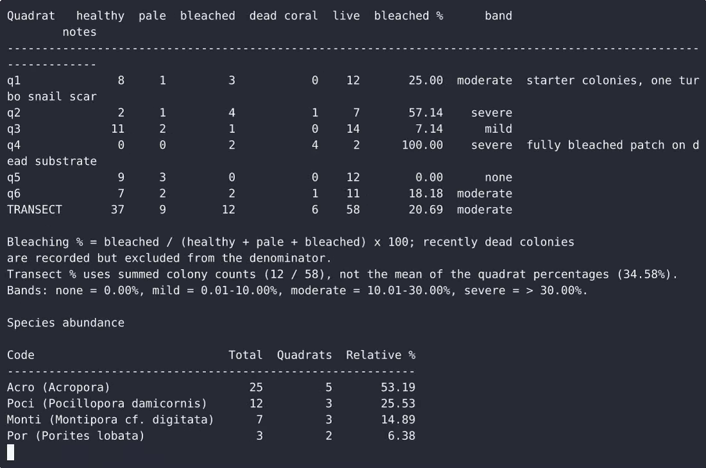
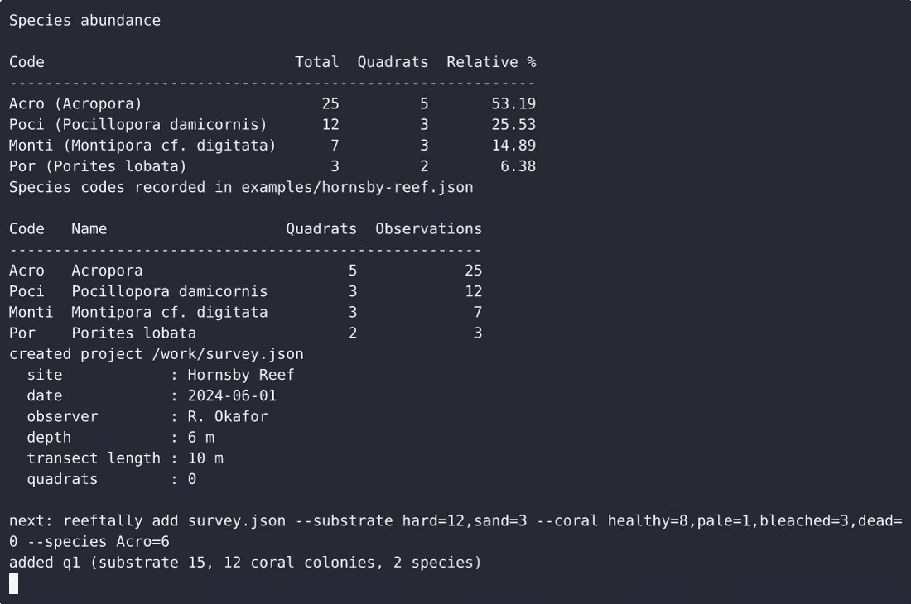

# ReefTally — complete Full-stack app command-line tool example app

Want to run your own command-line tool without paying for SaaS? **ReefTally** is a free, Apache-2.0-licensed Full-stack app project that you can clone and self-host today. ReefTally is a single-file, standard-library-only Python command-line tool for coral transect surveys: it records per-quadrat substrate tallies and coral-colony condition counts, calculates bleaching percentages (per…. Every ReefTally feature — every screen, every seed record — is here. [Open ReefTally on cenius.ai](https://cenius.ai/marketplace/p/reeftally?ref=gh&utm_campaign=reeftally-webapp) to modify it without writing code.


[](LICENSE)  [](https://cenius.ai)

[](https://cenius.ai/marketplace/p/reeftally?ref=gh&utm_campaign=reeftally-webapp)

> **▶ [Open & edit in cenius.ai](https://cenius.ai/marketplace/p/reeftally?ref=gh&utm_campaign=reeftally-webapp)** — one click to an editable workspace: describe changes in plain English, get an instant preview, one-click deploy and host. Modifications made on the platform come with full rebrand & relicense rights.

_Local clone? See [Quick start](#quick-start) below. cenius.ai is the zero-setup path._

## Demo


📽 **[Demo video on cenius.ai](https://cenius.ai/marketplace/p/reeftally?ref=gh&utm_campaign=reeftally-webapp)** — the complete run-through · [MP4](.github/media/demo.mp4)

## Screenshots

 

## Features

- Local JSON project file lifecycle
- Quadrat substrate tally entry
- Bleaching percentage calculator
- Species abundance log
- Terminal report tables
- CSV export
- Input validation and failure behaviour
- Species display names
- Remove the last quadrat

## Quick start

```bash
./install.sh   # installs dependencies + seeds demo data
```

See [`INSTALL.md`](INSTALL.md) for full setup and usage instructions.

## Architecture

A self-contained Full-stack app project (14 files): top-level directories include `examples/`. `install.sh` provisions dependencies and seeds demo data so the app starts with something real to explore. Step-by-step setup guide: [`INSTALL.md`](INSTALL.md).

## Usage guide

Every command below is copy-pasteable, in order, in an empty directory. Replace `python3` with your
interpreter if it is named differently.

### 1. Start a survey

```bash
python3 reeftally.py init survey.json --site "Hornsby Reef" --date 2024-06-01 \
    --observer "R. Okafor" --depth 6 --transect-length 10
```

```
created project /home/you/reef/survey.json
  site            : Hornsby Reef
  date            : 2024-06-01
  observer        : R. Okafor
  depth           : 6 m
  transect length : 10 m
  quadrats        : 0

next: reeftally add survey.json --substrate hard=12,sand=3 --coral healthy=8,pale=1,bleached=3,dead=0 --species Acro=6
```

`--date` defaults to today. Running `init` again over an existing file is refused unless you pass
`--force`; the old file is not touched.

### 2. Record quadrats

Flags (one line per quadrat, scriptable and pipe-friendly):

```bash
python3 reeftally.py add survey.json --substrate hard=12,sand=3 \
    --coral healthy=8,pale=1,bleached=3,dead=0 --species Acro=6,Poci=4 \
    --notes "starter colonies, one turbo snail scar"
```

```
added q1 (substrate 15, 12 coral colonies, 2 species)
```

_Full guide: [`USAGE.md`](USAGE.md)_

## FAQ

### How do I self-host ReefTally?

It runs entirely on your own machine. Clone, run `./install.sh`, and follow [`INSTALL.md`](INSTALL.md) — the whole stack is in this repo, no external dependencies required.

### Which technology stack does ReefTally use?

Full-stack app. The full source in this repository is exactly what the app runs. Highlights include local JSON project file lifecycle.

### Can I use ReefTally in a commercial project?

Yes — it ships under the Apache-2.0 license, which permits commercial use, modification and redistribution. The full text is in [LICENSE](LICENSE).

### Can I rebrand or white-label ReefTally?

Yes — and the easiest way is [remixing it on cenius.ai](https://cenius.ai/marketplace/p/reeftally?ref=gh&utm_campaign=reeftally-webapp): modifications made on the platform come with full rebrand and relicense rights over your derivative.

### What if I want to add features to ReefTally without coding?

[cenius.ai](https://cenius.ai/marketplace/p/reeftally?ref=gh&utm_campaign=reeftally-webapp) handles the implementation. Tell it what you want in everyday words, pick up the updated build. No coding needed.

## License & rebranding

Released under the [Apache License 2.0](LICENSE) (© 2026 Cenius AI) — free for personal and commercial use. The Cenius name/logo are trademarks (see NOTICE).

**Need a customized version?** [Remix this app on cenius.ai](https://cenius.ai/marketplace/p/reeftally?ref=gh&utm_campaign=reeftally-webapp) — modifications made on the platform come with **full rebrand & relicense rights** over your derivative.

## Built with cenius.ai

This entire application — code, design, seeded demo data — was generated on **[cenius.ai](https://cenius.ai)** from a plain-English description.

- 🚀 [Build your own app on cenius.ai](https://cenius.ai)
- 🎛️ [Remix ReefTally on the marketplace](https://cenius.ai/marketplace/p/reeftally?ref=gh&utm_campaign=reeftally-webapp) — open it in a workspace, prompt for changes, and ship your own version.

More open-source apps: [the Cenius-ai catalog](https://github.com/Cenius-ai) · [showcase index](https://github.com/Cenius-ai/showcase)
